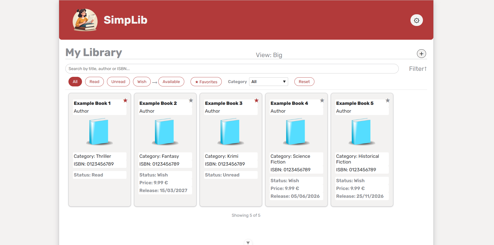

# SimpLib

[🇬🇧 English](README.md) | 🇩🇪 Deutsch

**Deine persönliche Bücherei: einfach, privat und offline nutzbar.**

SimpLib ist eine Progressive Web App (PWA) zur Verwaltung deiner eigenen Büchersammlung. Füge Bücher per Eingabe oder Scan der ISBN hinzu, führe eine Wunschliste mit Preisen und Erscheinungsdaten, markiere Favoriten und sichere deine Bibliothek als JSON-Datei. Es gibt kein Konto und keinen Server: Alle Daten bleiben auf deinem Gerät.



## Inhaltsverzeichnis

- [Features](#features)
- [Tech-Stack](#tech-stack)
- [Erste Schritte](#erste-schritte)
- [Verfügbare Skripte](#verfügbare-skripte)
- [Projektstruktur](#projektstruktur)
- [Funktionsweise](#funktionsweise)
- [Backup-Format](#backup-format)
- [Datenschutz](#datenschutz)
- [Browser-Unterstützung](#browser-unterstützung)
- [Code-Konventionen](#code-konventionen)

## Features

### Bibliotheksverwaltung

- Bücher hinzufügen, bearbeiten und löschen (Titel, Autor, Kategorie, ISBN, Status, Cover)
- Lesestatus: **Gelesen**, **Ungelesen** oder **Wunsch**
- Wunschlisten-Einträge können einen **Preis** und ein **Erscheinungsdatum** haben; ein Wunsch gilt als _Verfügbar_, sobald sein Erscheinungsdatum erreicht ist (oder keins eingetragen ist)
- Bücher als **Favoriten** markieren
- Freitext-Kategorien mit Vorschlägen (16 vordefinierte Kategorien, auf Deutsch und Englisch übersetzt)
- Bestätigungsdialog vor dem Löschen eines Buchs

### Bücher finden

- Suche nach Titel, Autor oder ISBN
- Filter nach Status, Favoriten, verfügbaren Wünschen und Kategorie
- Große und kleine Kartenansicht mit „Mehr anzeigen“-Paginierung (24 / 60 Bücher pro Seite)
- Startseite mit Übersichtskacheln (Wunschliste, Verfügbar, Gelesen, Ungelesen, Favoriten), die die Liste mit dem passenden Filter öffnen

### ISBN-Suche und Scanner

- Automatische Suche nach Titel, Autor und Cover über **Open Library** und **Google Books** (zweite Quelle als Fallback)
- Barcode-Scanner mit der Live-Kamera (kontinuierlicher Autofokus) oder per Foto, basierend auf ZXing (WASM) und der Barcode Detector API
- Bei Fotos werden mehrere Schwellwert-Binarisierungen ausprobiert, um die Erkennung zu verbessern
- Es können nur ISBN-13-Barcodes (978/979) gescannt werden; ISBN-10 lässt sich von Hand eintippen
- Lokale Prüfung von ISBN-Länge und -Zeichen

### Cover

- Eigenes Coverfoto hochladen (wird verkleinert und als JPEG neu kodiert)
- Gefundene Cover werden heruntergeladen und lokal gespeichert, sodass sie auch offline angezeigt werden
- Ältere Cover-Links werden im Hintergrund in den lokalen Speicher übernommen (höchstens einmal pro Tag, wenn du online bist)

### Daten und Einstellungen

- Bibliothek (inklusive Cover) als JSON-Sicherung exportieren
- Sicherung importieren und zwischen **Hinzufügen** (Zusammenführen) und **Ersetzen** wählen
- Alle Daten vom Gerät löschen
- Sprachwechsel zwischen **Deutsch** und **Englisch** (beim ersten Start automatisch erkannt)
- Integrierte Hilfeseite sowie Anzeige von Version und Build-Datum
- Beispielbücher beim ersten Start (nur einmal)

### PWA und Offline

- Installierbar auf Desktop und Smartphone
- Funktioniert nach dem ersten Laden komplett offline (nur die ISBN-Suche braucht eine Verbindung)
- Der Service Worker speichert alle Assets zwischen, auch die Scanner-WASM-Datei und die Schrift Rubik
- Automatische Updates

## Tech-Stack

| Bereich               | Technologie                                                                                                                    |
| --------------------- | ------------------------------------------------------------------------------------------------------------------------------ |
| Framework             | [Vue 3](https://vuejs.org/) (Composition API, `<script setup>`)                                                                |
| Sprache               | [TypeScript](https://www.typescriptlang.org/)                                                                                  |
| Build-Tool            | [Vite](https://vite.dev/)                                                                                                      |
| State-Management      | [Pinia](https://pinia.vuejs.org/)                                                                                              |
| Routing               | [Vue Router](https://router.vuejs.org/)                                                                                        |
| Internationalisierung | [Vue I18n](https://vue-i18n.intlify.dev/)                                                                                      |
| Speicher              | IndexedDB über [idb](https://github.com/jakearchibald/idb)                                                                     |
| Barcode-Scan          | [barcode-detector](https://github.com/Sec-ant/barcode-detector) Ponyfill + [zxing-wasm](https://github.com/Sec-ant/zxing-wasm) |
| PWA                   | [vite-plugin-pwa](https://vite-pwa-org.netlify.app/) (Workbox)                                                                 |
| Buchdaten             | [Open Library](https://openlibrary.org/developers/api) und [Google Books API](https://developers.google.com/books)             |
| Formatierung          | [Prettier](https://prettier.io/)                                                                                               |

## Erste Schritte

### Voraussetzungen

- Node.js `^22.18.0` oder `>=24.12.0`
- npm

### Installation

```sh
git clone https://github.com/PatLiCoding/simplib.git
cd simplib
npm install
```

### Entwicklungsserver starten

```sh
npm run dev
```

### Produktions-Build erstellen

```sh
npm run build
npm run preview
```

Der Build führt die Typprüfung (`vue-tsc`) aus und erzeugt ein statisches Bundle in `dist/`. Es kann auf jedem statischen Webserver gehostet werden.

> **Hinweis:** Der Live-Kamera-Scanner benötigt einen sicheren Kontext (HTTPS oder `localhost`). Bei unsicheren Verbindungen funktioniert die Option „Foto aufnehmen“ weiterhin.

## Verfügbare Skripte

| Skript               | Beschreibung                         |
| -------------------- | ------------------------------------ |
| `npm run dev`        | Startet den Vite-Entwicklungsserver  |
| `npm run build`      | Typprüfung und Produktions-Build     |
| `npm run build-only` | Build ohne Typprüfung                |
| `npm run preview`    | Zeigt den Produktions-Build lokal an |
| `npm run type-check` | Führt `vue-tsc` aus                  |
| `npm run format`     | Formatiert `src/` mit Prettier       |

## Projektstruktur

```text
src
├── assets
│   ├── data          # Beispielbücher (example.json)
│   ├── fonts         # Rubik Variable Font
│   ├── icon          # Scanner- und Foto-Icons
│   ├── img           # Logo, Standard-Buchcover
│   └── main.css      # globale Styles und gemeinsame Button-/Chip-/Dialog-Styles
├── components
│   ├── dialogs       # BookDialog, SettingsDialog, ImportDialog, ConfirmDialog,
│   │                 # IsbnField, IsbnScanner, CoverPicker
│   ├── booklist      # BookCard, FilterPanel, SearchBar
│   └── Header.vue
├── composables       # useBookDialog, useIsbnLookup, useLibraryTransfer, useSettingsDialog
├── db                # IndexedDB-Zugriff (booksDb.ts)
├── i18n              # Vue-I18n-Einrichtung und Sprachdateien (de, en)
├── router            # Routen: home, booklist, help
├── services          # Remote-ISBN-Suche (Open Library, Google Books)
├── stores            # Pinia-Store für die Büchersammlung
├── types             # gemeinsame TypeScript-Typen
├── utils             # Hilfsfunktionen: backup, barcode, camera, category, cover, image,
│                     # isbn, price, seed, status, version
├── views             # HomeView, BooklistView, HelpView
├── App.vue
├── globals.d.ts      # Build-Konstanten (__APP_VERSION__, __BUILD_DATE__)
└── main.ts
```

## Funktionsweise

- **Speicherung:** Die Bücher liegen in einer IndexedDB-Datenbank namens `simplib` (Object Store `books`). Kleine Merker (gewählte Sprache, „Beispiele bereits angelegt“, letzte Cover-Migration) stehen im `localStorage`.
- **Buchmodell:** Jedes Buch hat `id`, `createdAt`, `title`, `author`, `cover`, `isbn`, `category`, `price`, `releaseDate`, `status` und `favorite`.
- **ISBN-Suche:** Die Quellen werden nacheinander abgefragt, bis ein Buch gefunden wird. Die Fehlermeldung unterscheidet zwischen „nicht gefunden“, „eine Quelle nicht erreichbar“ und „offline“.
- **Scanner:** Im Live-Modus muss ein Code in zwei aufeinanderfolgenden Bildern gelesen werden, bevor er akzeptiert wird. Das verringert Fehlscans.
- **Kategorien:** Kategorien werden als stabile Schlüssel gespeichert (zum Beispiel `thrillerCrime`) und in der aktiven Sprache angezeigt. Eigene Kategorien werden so gespeichert, wie sie getippt wurden.
- **Offline:** Ein Service Worker legt die App-Shell, die Schriften und die Scanner-WASM-Datei im Voraus im Cache ab.

## Backup-Format

Exporte sind JSON-Dateien mit dem Namen `simplib-backup-JJJJ-MM-TT.json`:

```json
{
  "app": "simplib",
  "version": 1,
  "exportedAt": "2026-11-10T12:00:00.000Z",
  "books": [
    {
      "id": "…",
      "createdAt": 1762776000000,
      "title": "Example Book",
      "author": "Author",
      "cover": null,
      "isbn": "9783161484100",
      "category": "fantasy",
      "price": "9.99",
      "releaseDate": "2027-03-15",
      "status": "wish",
      "favorite": false
    }
  ]
}
```

Beim Import wird jedes Feld geprüft und bereinigt. Ungültige Einträge und doppelte IDs werden übersprungen, Dateien über 25 MB oder aus einer neueren Backup-Version werden abgelehnt, und ein fehlgeschlagener Import lässt deine Bibliothek unverändert.

## Datenschutz

- Kein Konto, kein Tracking, kein eigener Server
- Deine Bibliothek verlässt nie dein Gerät
- Nur die ISBN, die du suchst, wird an Open Library und Google Books gesendet
- Kamerabilder werden lokal verarbeitet und nie hochgeladen

Weil alles im Browser gespeichert wird, löscht das Entfernen der Website-Daten auch deine Bibliothek. Exportiere deshalb regelmäßig eine Sicherung.

## Browser-Unterstützung

SimpLib richtet sich an aktuelle Chromium-basierte Browser, Firefox und Safari. Das anpassbare Select-Styling (`appearance: base-select`) wird derzeit nur in Chromium-basierten Browsern dargestellt; andere Browser fallen auf das native Select zurück. Das Scannen mit der Live-Kamera hängt von der Unterstützung für `getUserMedia` und einem sicheren Kontext ab.

## Code-Konventionen

- Prettier: keine Semikolons, einfache Anführungszeichen, Zeilenbreite 100
- Keine Datei länger als 400 Zeilen, keine Funktion länger als 14 Zeilen; gemeinsame Logik wird in `utils` ausgelagert
- Alle Texte der Oberfläche stehen in den Sprachdateien (`de.json`, `en.json`)

## Autorin

Entwickelt von Patricia Linne
